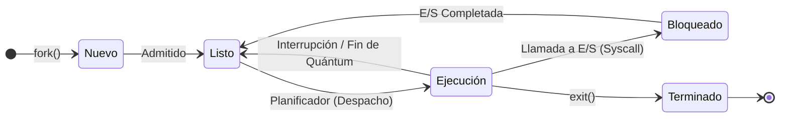
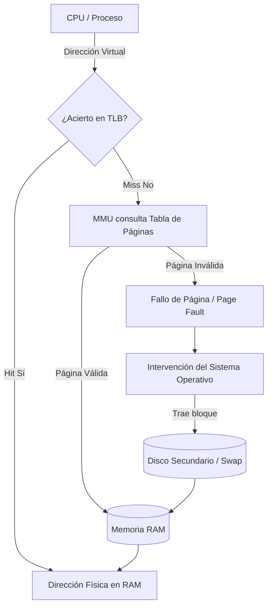
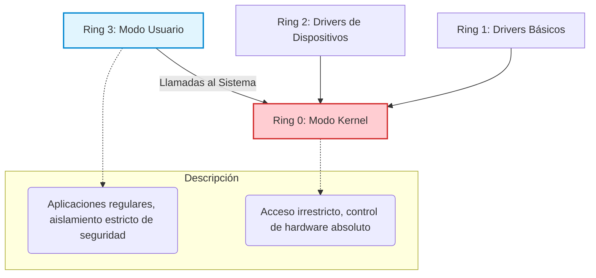
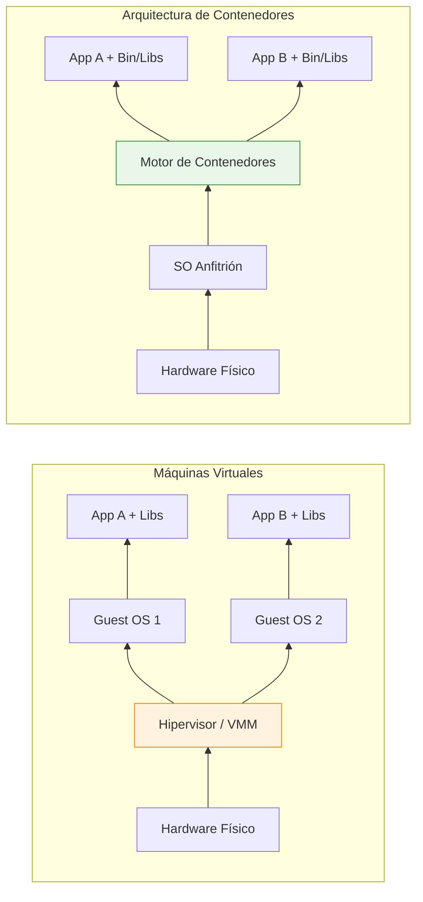

# Anexo A: Diagramas y Flujogramas Ilustrativos

En esta sección se exponen los esquemas visuales que describen la arquitectura y las transiciones internas del Sistema Operativo, vinculados directamente a los conceptos teóricos desarrollados en el glosario.

## 1. Transiciones de Estados del Proceso
*(Conceptos vinculados: Proceso, Planificación de CPU, PCB, Cambio de Contexto, Interrupción).*

## 2. Traducción de Memoria (MMU y TLB)
*(Conceptos vinculados: Memoria Virtual, Paginación, MMU, TLB, Fallo de Página, Swapping).*

## 3. Anillos de Protección (Jerarquía de Privilegios)
*(Conceptos vinculados: Ring 0, Ring 3, Modo Kernel, Modo Usuario, Llamadas al Sistema).*

## 4. Arquitectura de Contenedores vs Máquinas Virtuales
*(Conceptos vinculados: Máquina Virtual, Hipervisor, Contenedores, Cgroups, Namespaces).*

