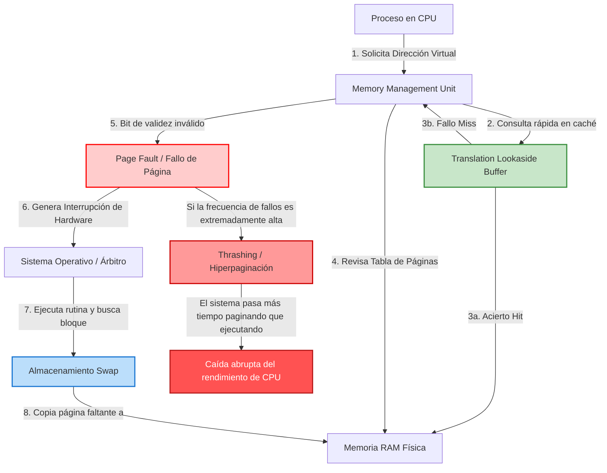

# Anexo C: Mapa de Relaciones

En cumplimiento con los requerimientos del proyecto, el siguiente grafo interactivo demuestra la interconexión teórica y operativa entre conceptos críticos de gestión de memoria virtual. 

El mapa ilustra el ciclo de vida de una solicitud de memoria, partiendo desde la traducción hasta la resolución de un fallo de página, y cómo la saturación de este proceso desemboca en el temido estado de hiperpaginación.

